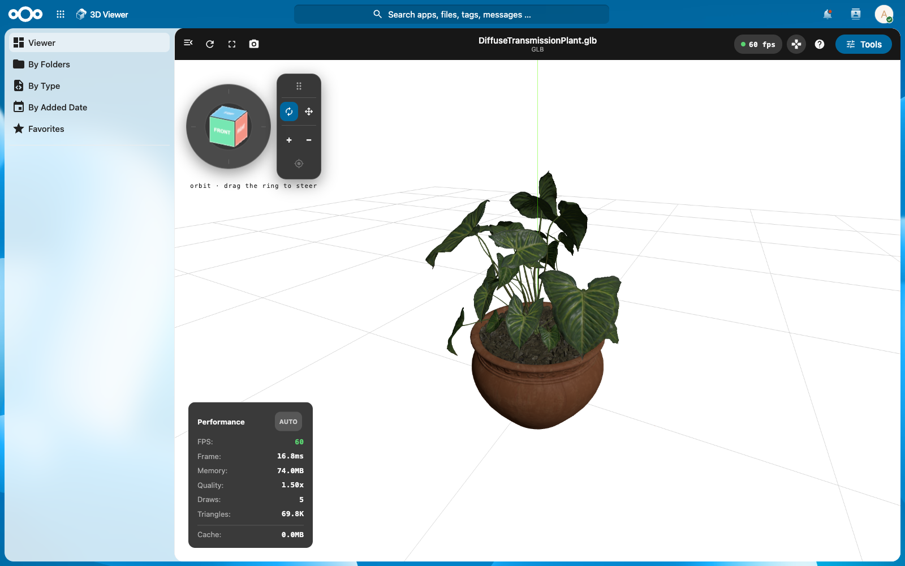
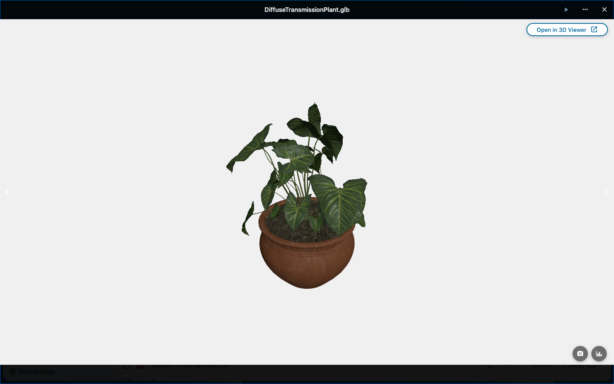
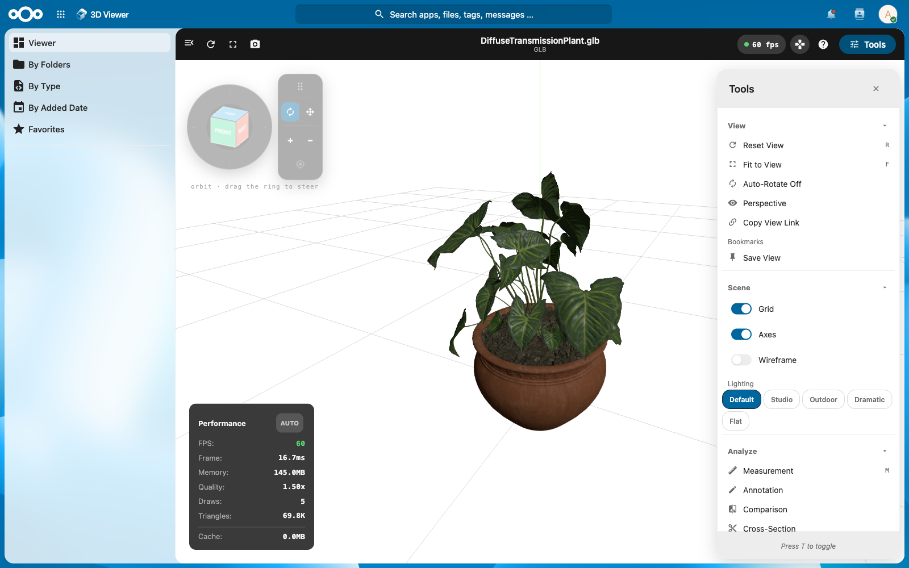
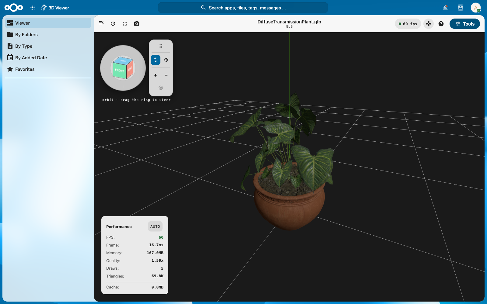
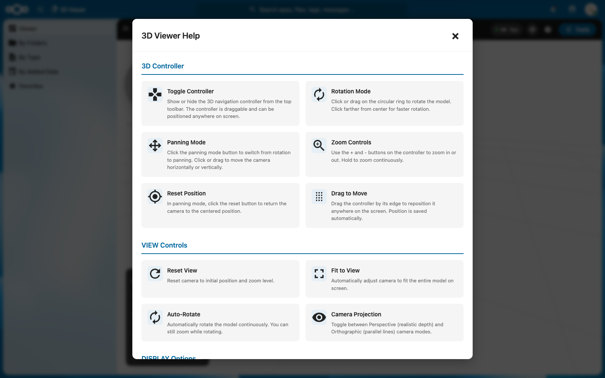
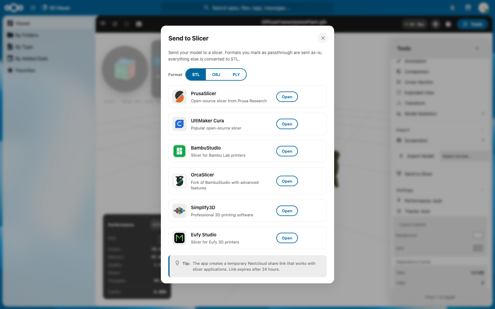

# 3D Viewer for Nextcloud

[](https://github.com/maz1987in/3Dviewer-Nextcloud/releases)
[](LICENSE)
[](https://nextcloud.com)
[](https://github.com/maz1987in/3Dviewer-Nextcloud/actions/workflows/update-nextcloud-ocp-matrix.yml)
[](https://github.com/maz1987in/3Dviewer-Nextcloud/actions/workflows/release.yml)

A comprehensive 3D model viewer application for Nextcloud that supports multiple 3D file formats with advanced features like dynamic grid sizing, model comparison, and real-time streaming.

## 📸 Screenshots

<table>
  <tr>
    <td align="center">
      <br/>
      <b>Main Viewer</b><br/>
      Orbit, pan and zoom from the ring controller, with a live frame-rate readout
    </td>
    <td align="center">
      <br/>
      <b>Files Integration</b><br/>
      Models preview in place in the Files app, one click from the full viewer
    </td>
  </tr>
  <tr>
    <td align="center">
      <br/>
      <b>Tools Panel</b><br/>
      Every tool in one panel, grouped and collapsible, with its keyboard shortcut
    </td>
    <td align="center">
      <br/>
      <b>Light and Dark</b><br/>
      Auto follows the instance; choosing a theme moves the whole viewer, and the panels floating on the render take the opposite shade so they keep an edge against it
    </td>
  </tr>
  <tr>
    <td align="center">
      <br/>
      <b>Help and Shortcuts</b><br/>
      Every control explained, each row drawn with the icon that control uses
    </td>
    <td align="center">
      <br/>
      <b>Send to Slicer</b><br/>
      Hand a model to PrusaSlicer, Cura, BambuStudio and others over a temporary share link
    </td>
  </tr>
</table>

## 📚 Documentation

- **[User Guide](docs/README.md)** - Complete installation, usage, and feature documentation
- **[Technical Documentation](docs/TECHNICAL.md)** - Architecture, API, and implementation details
- **[Troubleshooting Guide](docs/TROUBLESHOOTING.md)** - Common issues and solutions
- **[Testing Guide](docs/TESTING.md)** - Testing procedures and guidelines
- **[Contributing Guide](CONTRIBUTING.md)** - How to contribute to the project

## ✨ Key Features

- **Thumbnails in Files** - Models get a thumbnail while you browse a folder, without being opened. Your browser renders them in the background, one file at a time, within per-user limits on file size, time and download per folder. A thumbnail is kept per file version and shown to everyone who can see the file, including share recipients and public links
- **Multi-Format Support** - 33 extensions across 22 formats: GLB, GLTF, OBJ (+MTL), STL, PLY, FBX, 3MF, 3DS, DAE, X3D, VRML, OFF, AMF, 3DM (Rhino), BIM (dotbim), IFC, STEP, IGES, BREP, FCSTD (FreeCAD), G-code (`.gcode`, `.gco`, `.nc`, `.acode`, `.g`, `.gx`, `.g3drem`, `.makerbot`, `.thing`)
- **G-code Toolpath Visualization** - View 3D printer and CNC toolpaths with smooth rainbow gradient coloring, intelligent travel/retraction filtering, and a layer slider to step through the print
- **Enhanced File Loaders** - Significantly improved FBX, VRML, and DAE loaders with better material and texture support
- **Multi-File Models** - Full support for OBJ+MTL+textures and GLTF+bins+images
- **Personal Settings** - User-specific preferences and settings page integrated with Nextcloud personal settings
- **Mobile-Optimized UI** - Responsive toolbar with icons-only on small screens, full-screen help panel with sticky header, and performance stats hidden by default on screens ≤768px
- **Measurement & Annotation Visual Controls** - Customizable sizing controls (point size, line thickness, label width) for measurements and annotations
- **Animation Controls** - Play/pause, loop toggle, timeline scrubber with frame stepping for animated models
- **Cross-Section Tool** - Interactive clipping plane to slice models along X/Y/Z axes for interior inspection
- **Lighting Presets** - Quick-switch between Default, Studio, Outdoor, Dramatic, and Flat lighting setups
- **View Bookmarks** - Save and restore camera positions with display state (grid, axes, wireframe, background)
- **Exploded View** - Animate multi-mesh models outward from centroid with adjustable factor slider for assembly inspection
- **Performance Scaling** - Automatic performance mode suggestions for large models with configurable triangle count thresholds
- **Cache Insights** - Live dependency cache statistics (size, entries, hit rate) visible in viewer and tools panel
- **Enhanced Security** - Every action that changes data checks Nextcloud's request token, password-protected shares stay protected (checked by a test over every public route), and slicer temp files have size limits, MIME validation and rolling expiration
- **Bundle Budget Enforcement** - Automated bundle size checking with historical tracking and CI integration
- **Smart File Browser** - Toggle between Viewer, Folders, Type, Date, and Favorites modes with breadcrumbs, Nextcloud-style navigation, lazy loading, and customizable default view (Grid/List)
- **Dynamic Grid System** - Automatically adapts to model size and position
- **Model Comparison** - Side-by-side model viewing with synchronized controls, against another file or an earlier version of the same file
- **Compare with an Earlier Version** - Pick one of the versions Nextcloud kept and see it beside the current model with what changed, or as a see-through ghost over it
- **Print Check** - See whether a model fits your printer's build volume (common printers or your own size), which surfaces overhang past an angle you choose, roughly how much filament it needs, and which walls are thinner than a minimum you set; for G-code, the print time and filament the slicer worked out
- **Turntable Video** - Record one full turn around the model (4–15 s, at 720p, 1080p or your window's size) and download it as WebM or MP4, or save it next to the model in your Nextcloud
- **Shared Notes** - Annotations, distance and angle measurements are saved with the model and shown to everyone who can open it; anyone who can edit the model can add or change them
- **Measurements in Real Units** - Distances, areas, volumes and exports use the unit of the format the model came from: metres for glTF, IFC and X3D, millimetres for STL, 3MF, OBJ and CAD formats, and the file's own unit for Rhino, 3MF and FBX
- **3D Camera Controller** - Enhanced intuitive circular controller for precise camera navigation with improved controls
- **Face Labels** - Orientation markers (TOP, BOTTOM, FRONT, BACK, LEFT, RIGHT) on model faces
- **Screenshot Capture** - Take high-quality PNG/JPEG screenshots of 3D models
- **Export Functionality** - Export models to GLB, STL, OBJ, 3MF, PLY and USDZ formats
- **Render Modes** - Clay, Normals and X-ray shading to inspect surface form, flipped faces and assembly interiors
- **Slicer Integration** - Send models directly to PrusaSlicer, Cura, BambuStudio, OrcaSlicer, Simplify3D, Eufy Studio, and AnycubicSlicer with enhanced security (file size limits, MIME validation, rolling expiration)
- **Camera Projection Toggle** - Switch between perspective and orthographic views
- **Enhanced Camera Controls** - Improved camera composable with additional functionality and better user experience
- **Progressive Texture Loading** - Background loading for improved performance
- **Dependency Caching** - IndexedDB caching for faster multi-file model loading with live cache statistics (size, entries, hit rate)
- **Model Statistics Panel** - Size, surface area, volume, and mesh, vertex, face, material and texture counts for the loaded model, in its real unit
- **Help Panel** - Comprehensive in-app documentation and controls guide
- **Performance Optimized** - Code splitting, dynamic imports, quality modes with visual overlay, and automatic performance suggestions for large models
- **Theme Integration** - Respects Nextcloud light/dark themes with RTL support
- **Accessibility** - Every control in the tools panel works from the keyboard and tells a screen reader its name and state, with High Contrast support
- **Compression Support** - DRACO geometry and KTX2/Basis texture compression
- **Live File Indexing** - Database-backed index updates automatically via filesystem events with CLI/REST helpers for bulk reindexing

## 🚀 Quick Start

### Installation

#### From Nextcloud App Store (Recommended)

1. Open your Nextcloud instance
2. Go to **Apps** (top-right menu)
3. Search for "**3D Viewer**"
4. Click **Download and enable**

MIME types are registered automatically during installation!

#### Manual Installation

```bash
# Clone or download the app
git clone https://github.com/maz1987in/3Dviewer-Nextcloud.git
cd 3Dviewer-Nextcloud

# Install dependencies and build
composer install --no-dev
npm install
npm run build

# Deploy to Nextcloud
cp -r . /path/to/nextcloud/apps/threedviewer/

# Enable the app
php occ app:enable threedviewer
```

**Post-Installation:** If you uploaded 3D files before installing the app, rescan them:

```bash
php occ files:scan --all
```

### Basic Usage

1. **Upload** 3D files to your Nextcloud Files
2. **Click** on any 3D file (`.glb`, `.gltf`, `.obj`, `.stl`, etc.)
3. **Navigate** using mouse/touch:
   - **Rotate**: Left click + drag (or one finger)
   - **Zoom**: Mouse wheel (or pinch)
   - **Pan**: Right click + drag (or two fingers)
   - **Reset**: Double-click (or double-tap)

For detailed usage instructions, see the [User Guide](docs/README.md).

### Rebuilding the 3D File Index

The new navigation views are powered by a dedicated `tv_file_index` table. Newly uploaded, edited, or deleted 3D files are indexed automatically, but if you install the app on an instance that already contains models you can rebuild the index with:

```bash
php occ threedviewer:index-files          # Reindex all users
php occ threedviewer:index-files alice    # Reindex a single user
```

The UI will also call `POST /apps/threedviewer/api/files/index` the first time it notices an empty index, so admins rarely need to run the command manually.

## 📦 Supported Formats

### 3D Model Formats

| Format | Extension | Multi-file Support | Notes |
|--------|-----------|-------------------|-------|
| GLTF   | `.gltf`, `.glb` | Yes (bins, images) | Preferred format, full support |
| OBJ    | `.obj`    | Yes (MTL, textures) | Requires MTL for materials |
| STL    | `.stl`    | No | 3D printing format |
| PLY    | `.ply`    | No | Point cloud support |
| FBX    | `.fbx`    | Limited | Autodesk format |
| DAE    | `.dae`    | Limited | Collada format |
| 3DS    | `.3ds`    | Limited | 3D Studio format |
| 3MF    | `.3mf`    | No | 3D Manufacturing format |
| X3D    | `.x3d`    | Limited | Web3D standard |
| VRML   | `.wrl`, `.vrml` | Limited | Legacy format |
| OFF    | `.off`    | No | Geomview Object File Format (plain-text, COFF vertex colors) |
| AMF    | `.amf`    | Yes (ZIP-compressed) | Additive Manufacturing Format (XML, ISO/ASTM 52915) |
| 3DM    | `.3dm`    | No | Rhinoceros (WASM, ~4 MB lazy-loaded) |
| BIM    | `.bim`    | No | dotbim (JSON-based BIM, zero WASM) |
| IFC    | `.ifc`    | No | Industry Foundation Classes (BIM, web-ifc WASM ~5 MB lazy-loaded) |
| STEP   | `.step`, `.stp` | No | CAD NURBS (OCCT WASM ~7 MB, shared across STEP/IGES/BREP/FCSTD) |
| IGES   | `.iges`, `.igs` | No | Legacy CAD NURBS (shared OCCT WASM) |
| BREP   | `.brep`, `.brp` | No | OpenCascade native B-Rep (shared OCCT WASM) |
| FCSTD  | `.fcstd`  | No | FreeCAD document (ZIP containing BREP bodies, shared OCCT WASM); draws the objects FreeCAD shows |
| G-code | `.gcode`, `.gco`, `.nc`, `.acode`, `.g`, `.gx`, `.g3drem`, `.makerbot`, `.thing` | No | 3D printer and CNC toolpaths, with a layer slider |

> WASM loaders are lazy-chunked — the 3–7 MB runtime only downloads when a user opens a file of that format.

> Every format gets a thumbnail in Files. The XML formats (3MF, AMF, DAE, X3D) and FreeCAD files are parsed in the background worker too; `.nc` and `.g`, whose extensions other software also uses, get theirs when opened in the viewer.

### Supporting File Types

**Material & Dependency Files:**
- `.mtl` - Material definitions for OBJ files
- `.bin` - Binary data for GLTF models

**Texture Formats** (for multi-file models):
- `.png`, `.jpg`/`.jpeg` - Standard web formats
- `.tga` - Targa image format
- `.bmp` - Bitmap format
- `.webp` - Modern web format

> **Note**: Supporting files (MTL, BIN, textures) are automatically loaded when present in the same directory as the main model file. A texture named by a full path or a path above the model's folder (`C:\…\wood.jpg`, `..\..\textures\wood.jpg`) is found by its file name beside the model.

## 🤝 Contributing

Contributions are welcome! Please see our [Contributing Guide](CONTRIBUTING.md) for:
- Code standards and best practices
- Development environment setup
- Pull request process
- Testing requirements

## 📄 License

Copyright © 2025-2026 Mazin Al Saadi. Licensed under AGPL-3.0-or-later.

This project is licensed under the **AGPL-3.0 License**. See [LICENSE](LICENSE) for details.

## 🔗 Links

- **GitHub**: [github.com/maz1987in/3Dviewer-Nextcloud](https://github.com/maz1987in/3Dviewer-Nextcloud)
- **Changelog**: [CHANGELOG.md](CHANGELOG.md)
- **Issues**: [GitHub Issues](https://github.com/maz1987in/3Dviewer-Nextcloud/issues)
- **Discussions**: [GitHub Discussions](https://github.com/maz1987in/3Dviewer-Nextcloud/discussions)

## 📊 Version

**Current Version**: 3.9.0
**Released**: October 28, 2026
**Requires**: Nextcloud 31 -- 35

### What's New in 3.9.0

**Compare with an earlier version:**
- Pick one of the versions Nextcloud kept, and see the two side by side with what changed, or the earlier one as a see-through ghost over the current one

**Print check:**
- Whether a model fits your printer's build volume, and by how much it doesn't
- Overhang shading past an angle you choose, a filament estimate, and a wall thickness check
- For G-code, the print time and filament the slicer worked out

**Turntable video:**
- Record the model turning, from the tools panel's Export section, and download it or save it next to the model

**Viewer:**
- While a dialog is open, keys belong to it: the tool shortcuts and Escape no longer act on the viewer behind it

### Recent releases

- **3.8.1:** thumbnails show the model as its file has it, every tools panel control works from the keyboard, textures named by a path above the model's folder are found, and every write route checks the request token
- **3.8.0:** angle measurement, a G-code layer slider, Clay, Normals and X-ray shading, export to 3MF, PLY and USDZ, and measurements in each model's real unit
- **3.7.1:** background thumbnails for 3MF, AMF, DAE and X3D, and FreeCAD files drawn as FreeCAD shows them
- **3.7.0:** thumbnails made while browsing Files, shared by everyone who can see the file
- **3.6.0:** annotations and measurements become shared notes, and Nextcloud 35 support

See [CHANGELOG.md](CHANGELOG.md) for detailed release notes and complete version history.

---

For detailed technical information, API documentation, and architecture details, see the [Technical Documentation](docs/TECHNICAL.md).
